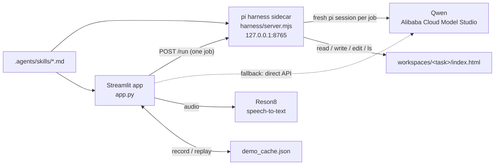

# Technical documentation

This document is for developers who want to run, change or extend Requirement Clarifier. For how to use the app, see the [user guide](USER_GUIDE.md).

## Architecture



| Part | What it does |
| --- | --- |
| `app.py` | The whole Streamlit app: pages, session state, the AI calls with their JSON schemas, the knowledge base and the record/replay cache. |
| `harness/server.mjs` | A small Node HTTP server built on the pi SDK. Every request is one *job*, run in a fresh in-memory pi agent session. |
| `harness/agent/models.json` | pi's model registry: the `dashscope` provider and the Qwen model with the compatibility flags it needs. |
| `.agents/skills/` | Skills (`SKILL.md`) whose instructions are inlined into the system prompt of a job. |
| `workspaces/<task>/` | Per-task folder where pi builds the prototype (`index.html`). The name is `task<id>-<md5(project)[:6]>`, ASCII only so Python and Node agree on it. |
| `demo_cache.json` | Every AI answer, keyed by its inputs, for offline replay on stage. |

All state lives in Streamlit's `session_state`: there is no database, refreshing the browser starts over, and each browser tab is its own session.

## Running locally

```powershell
pip install -r requirements.txt     # streamlit, openai (pandas and altair come with streamlit)
cd harness; npm install; cd ..      # needs Node.js 22.19+ (required by the pi packages)
streamlit run app.py
```

Keys are read from files next to `app.py`, both git-ignored:

| File | Environment variable | Used for |
| --- | --- | --- |
| `apikey.txt` | `DASHSCOPE_API_KEY` (read by the harness only) | Qwen, through pi and through the direct fallback |
| `reson8key.txt` | `RESON8_API_KEY` | Reson8 transcription. The file may hold the bare key or a `name = "key"` line. |

The app uses Model Studio's **international** endpoint. For a mainland China key, change `BASE_URL` in `app.py` and `baseUrl` in `harness/agent/models.json` to `https://dashscope.aliyuncs.com/compatible-mode/v1`.

The pi packages are pinned to `1.1.0` through `overrides` in `harness/package.json`. Later sibling versions don't work together, so don't let npm float them.

## The pi harness

### Lifecycle

`start_harness()` (cached with `st.cache_resource`) reuses a sidecar that already answers `GET /health`; otherwise it starts `node server.mjs` in `harness/`, sends its output to `harness/harness.log` and waits up to 30 s. If the process exits early, the error contains the tail of that log. The sidebar's model picker calls it, so a broken harness shows up there.

### Protocol

`GET /health` returns `{ ok, models, default }`, where `models` is every model pi can reach (`provider/id`).

`POST /run` takes one job and returns `{ result?, text, steps, model, ms }`, or `{ error }` with HTTP 500.

| Job field | Meaning |
| --- | --- |
| `system` | System prompt. |
| `prompt` | User message. |
| `schema` | Optional JSON schema. The harness adds a `submit_result` tool with these parameters and tells the model to call it once; the call ends the run and its arguments become `result`. If the model stops without calling it, the harness asks once more. |
| `tools` | pi built-in tools to enable (`read`, `write`, `edit`, `bash`, `grep`, `find`, `ls`). None by default. |
| `workspace` | Tools act inside `workspaces/<workspace>/` (sanitised to `[\w-]`). |
| `skills` | Names under `.agents/skills/`; each `SKILL.md` body (frontmatter removed) is appended to the system prompt. |
| `model` | `provider/id`, default `dashscope/qwen3.8-max`. |
| `thinking` | pi thinking level, default `off`. |

Each job gets a resource loader that discovers nothing (no extensions, skills, prompts or `AGENTS.md`), so the job alone decides what the agent sees. Sessions are in memory, compaction is off, and pi retries up to twice on errors. `steps` lists the tool calls (`{tool, args}`) so the UI can show what pi did.

Qwen needs `compat.thinkingFormat: "qwen"` and `supportsDeveloperRole: false` in `models.json`; without them calls are very slow or fail with HTTP 400.

### Fallback chain

Every AI call in `app.py` goes through `via_harness(job, direct)`:

1. **pi**, when *Settings → AI engine* is `pi` (the default).
2. **Direct Qwen API** (`openai` client) if pi fails or the engine is `direct`. Structured calls force the tool with `tool_choice` and `enable_thinking: False`; agent calls ask for the whole file in one code block, since the direct API has no tools.
3. **The recording** in `demo_cache.json` if the live call fails and a recording exists.

## AI calls

There are two shapes of call:

- `call_tool(system, content, name, schema, skills)` returns a structured result. The output passes through `coerce()`, which repairs common model mistakes against the schema (missing fields, arrays sent as JSON strings, bare strings where objects were expected) so rendering never crashes.
- `call_agent(system, content, name, workspace, out_file, tools)` runs a tool-using pi job that writes a file in the task's workspace and returns its content and pi's steps.

The `keep-it-short` skill (word budgets for everything shown on screen) is applied to every call through `BASE_SKILLS`.

| Function | Call name | Output | Extra skills |
| --- | --- | --- | --- |
| `analyze` | `task_analysis` | Title, understanding, deadline, subtasks, known facts, first questions (≤3, each addressed to a stakeholder), meeting suggestion, inferred stakeholders | `grill-me` |
| `clarify` | `clarify_round` | Updated understanding, `complete`, remaining open points, next questions, conflicts (≤2) with 2–3 resolutions | `grill-me` |
| `write_brief` | `task_brief` | Goal, scope in/out, acceptance criteria, subtasks, decisions with their source, open issues | |
| `make_demo` | `demo_html` | Agent job: pi writes `workspaces/<task>/index.html`, or edits it for change requests | |
| `answer_worker` | `worker_answer` | Answer with its basis, or a question forwarded to the stakeholder who owns it | `grill-me` |
| `answer_kb` | `kb_answer` | Answer from one project's document and timeline, with sources | |
| `answer_all` | `kb_all_answer` | Answer across all projects, with the projects it used | |
| `write_minutes` | `meeting_minutes` | Summary, speaker → stakeholder mapping, decisions, wishes, action items, open questions | |
| `change_impact` | `change_impact` | Headline, before/after changes with their cause, who to notify, rework level | |

Schemas are the `*_SCHEMA` constants near the top of `app.py`. Their field descriptions carry the length limits and rules the model must follow.

### The Q&A log and its references

`S.qa` holds every input from stakeholders for the current task. `qa_md()` renders it for prompts with numbered references, which briefs, prototypes and change cards cite as their source:

| Ref | Kind (`kind` field) | Comes from |
| --- | --- | --- |
| `Q1` | none | An answer to a clarifying question |
| `W1` | `wish` | A wish someone added unprompted, or a new request raised in a meeting |
| `D1` | `decision` | The owner settling a conflict card |
| `M1` | `meeting` | A meeting decision, or a question a meeting left open |

## Main flows

### Clarification loop

1. `analyze` proposes the stakeholders (a project keeps its cast across tasks) and the first questions. The first stakeholder is the owner.
2. Each question is addressed to one stakeholder. `route()` maps the AI's addressee onto the cast; unknown names go to the owner. The person at the keyboard switches roles with *Acting as* or the **Answer as …** buttons.
3. A round closes once every question has an answer and every conflict a decision. `close_round()` commits them to `S.qa` and calls `clarify` for the next round.
4. The loop ends when `clarify` returns `complete` with no questions or conflicts, when the owner clicks **Enough, write the brief**, or after `MAX_ROUNDS` (4). Anything still open goes into the brief's open issues.

New input after the loop has ended (a wish, a meeting) goes through `react()`: `clarify` runs again and may reopen questioning with follow-ups or conflicts.

### Meeting notes (Reson8)

1. Audio comes from `st.audio_input` (recording), `st.file_uploader` (wav, mp3, m4a, ogg, flac, webm, mp4) or the sample at `samples/meeting_sample.wav`. A pasted transcript skips transcription.
2. `transcribe()` posts the raw bytes to `https://api.reson8.dev/v1/speech-to-text/prerecorded` with `diarize=true`, `include_timestamps=true` and `filler_mode=clean`, plus the stakeholder names as `phrases` so Reson8 spells them right. Consecutive segments of one speaker are merged into `[mm:ss] Speaker N: …` lines.
3. `write_minutes()` maps speakers to stakeholders and extracts only what was said.
4. `apply_meeting()` turns decisions and open questions into `M` entries and new requests into `W` entries, saves a *Meeting* record with the minutes and the transcript, then calls `react()`.

Reson8 supports ten European languages (English, German, French, Spanish, Italian, Dutch, Portuguese, Polish, Swedish, Frisian), not Chinese. For other languages, paste a transcript.

### Brief rewrite and change impact

`gen_brief()` writes the brief. On a rewrite (when a brief already existed) it also:

- keeps the prototype and marks it stale (`S.demo_stale`) instead of discarding it;
- calls `change_impact()` with the old brief, the new brief and the full Q&A log, saying how many entries are new;
- saves a *Change* record and logs a *Requirement changed* event.

The change card offers **Update the demo for these changes**, which calls `make_demo` with the changes as feedback. pi then edits the existing `index.html` rather than rebuilding it.

`S.history` (what the worker Q&A and the prototype build from) is `S.qa` plus anything added after the brief: answers given during work and demo change requests. Both survive a rewrite.

### Prototype

`make_demo()` asks pi to write a single-file, offline HTML prototype in which every answer that changes what the user sees is visible and working, with a collapsed "Built from your answers" section mapping features to Q/W/D/M references. A fresh build deletes the old page first; change requests edit it in place. The UI shows the page in an iframe from a `data:` URL, so the generated code gets its own origin and can't reach the app.

### Worker Q&A

`answer_worker()` answers only from the brief and `S.history`. If the basis is missing, the question goes to `S.pending`, addressed to the stakeholder who owns the decision. Their answer is added to `S.history`, so the next similar question can be answered directly.

### Export

`github_issue_md()` and `jira_markup()` render the brief deterministically, with no AI call: GitHub task lists for acceptance criteria and subtasks, a decisions table with sources, the stakeholders and the open questions. The Jira version uses Jira wiki markup.

## State and knowledge base

`TASK_DEFAULTS` holds the current task (cleared by **New task**); `KB_DEFAULTS` holds everything kept across tasks (cleared by **Clear all**). Widget keys starting with one of `TASK_WIDGET_PREFIXES` are cleared with the task.

Knowledge is captured in two lists:

- `S.docs`: records `{key, project, task_id, task, type, title, content, time}`. Saving with an existing `key` overwrites that record in place. Types are `Task`, `Brief`, `Demo`, `Q&A`, `Meeting` and `Change`.
- `S.events`: the timeline, `{time, project, task, type, text}`, e.g. *Task posted*, *Clarification round*, *Conflict settled*, *Wish added*, *Meeting held*, *Brief rewritten*, *Requirement changed*, *Demo revised*, *AI answered*, *Forwarded to stakeholder*, *Stakeholder answered*, *Subtask done*.

`project_doc_md()` assembles one Markdown document per project from those records. The knowledge-base Q&A calls get the full document and timeline.

Record keys follow `<task_id>-<kind>[-<n>]`: `task`, `brief`, `demo`, `clar-<i>`, `dec-<hash>`, `wish-<n>`, `meet-<n>-<i>`, `minutes-<n>`, `chg-<n>`, `ask-<hash>`, `demofb-<n>`.

### Metrics

`project_stats()` derives the "value" numbers from the records:

- **Caught before coding**: records whose key contains `-clar-`, `-dec-`, `-wish-` or `-meet-` (clarifying answers, settled conflicts, wishes, meeting notes).
- **Rework avoided** ≈ caught × `REWORK_H` (2 h) + worker questions the AI answered × `INTERRUPT_H` (0.25 h).

Both constants are estimates and are labelled as such in the UI.

## Record and replay

`cached(name, system, content, produce)` keys each answer by `sha1(name, system, content)`, with the `Today is YYYY-MM-DD.` line removed so rehearsal answers still match on demo day. With offline mode on and a recording present, it replays it after a 0.8 s pause; otherwise it calls live and records the answer. A failed live call falls back to its recording.

Things to know:

- Skills are **not** part of the key. After changing a skill, replay still returns answers recorded under the old one; re-record by running the flow with offline mode off.
- Reson8 transcriptions are keyed by the audio bytes alone, so the sample meeting replays whatever the stakeholder names are. A newly recorded meeting never matches; on stage, upload the file you rehearsed with.

## Extending

- **A new AI step:** define a schema, write a function that builds `system` and `content` and calls `call_tool(...)`, then render the result. Recording, fallback and `coerce()` come for free.
- **A new skill:** add `.agents/skills/<name>/SKILL.md` (frontmatter is stripped) and pass its name in `skills=(...)`, or add it to `BASE_SKILLS` to apply it everywhere.
- **Another model:** add it to `harness/agent/models.json`; it then appears in *Settings → Model*. For the direct fallback, change `MODEL` and `BASE_URL` in `app.py`.
- **A new example scenario:** add an entry to `SCENARIOS` with its project, task text and preset worker and knowledge-base questions.

## Known limitations

- Single user, no persistence: all state is in the browser session.
- `app.py` always talks to the harness on port 8765, even though `server.mjs` reads `HARNESS_PORT`.
- `harness/node_modules` is committed from a Windows install. On macOS or Linux, run `npm install` in `harness/` again.
- Reson8 puts both voices of the synthetic sample meeting (`samples/meeting_sample.wav`) under one speaker, because the computer voices are too alike. Real recordings are separated by speaker. With the sample, the minutes still attribute statements from what people say about themselves.
- The UI is in English; `app_zh.py` is an earlier, simpler Chinese version without pi or stakeholders.
